# Enterprise Backend API Template — Technical Reference & Architecture Blueprint

This document serves as the comprehensive technical reference, design blueprint, and developer handbook for the **Backend Template**. It details **what problem each component solves**, provides **visual diagrams and flowcharts**, illustrates **real-world scenarios**, and includes **before-and-after code comparisons**.

---

## 1. Clean Architecture & Layer Responsibilities

The codebase strictly enforces **Clean Architecture** (Separation of Concerns). Dependencies flow only inward toward the domain/business logic.

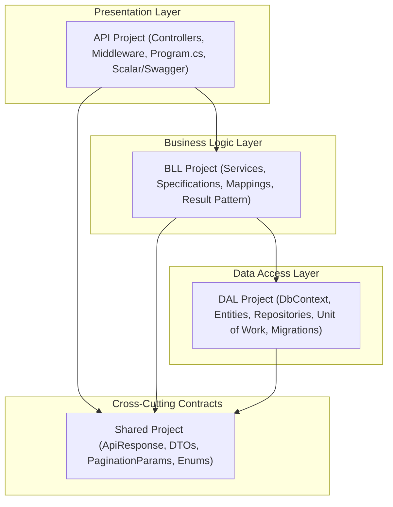

### Layer Responsibilities & Problem Mapping

| Layer | Responsibility | What Problem It Solves |
| :--- | :--- | :--- |
| **API** | HTTP handling, routing, CORS, Rate Limiting, request localization, OpenAPI/Scalar docs. | Prevents HTTP concerns (headers, status codes, cookies) from leaking into business logic. |
| **BLL** | Business rules, validations, JWT generation, specifications, domain services. | Centralizes business rules so they are reusable and testable without a web server. |
| **DAL** | EF Core DbContext, entity definitions, generic repositories, Unit of Work. | Encapsulates database queries, SQL generation, transactions, and entity configurations. |
| **Shared** | DTO contracts, `ApiResponse<T>`, `PaginationParams`, query parameters. | Avoids circular dependencies and guarantees consistent API contracts across teams. |

---

## 2. Authentication & Security Architecture

### The Problem
* Storing JWT tokens in `localStorage` makes them vulnerable to **XSS (Cross-Site Scripting)** attacks where malicious scripts can steal the user's token.
* Passwords can be brute-forced without account lockouts.
* Volumetric bot attacks (DoS) can overwhelm servers with heavy password hashing operations.

---

### The Solution: Multi-Layered Security Flow

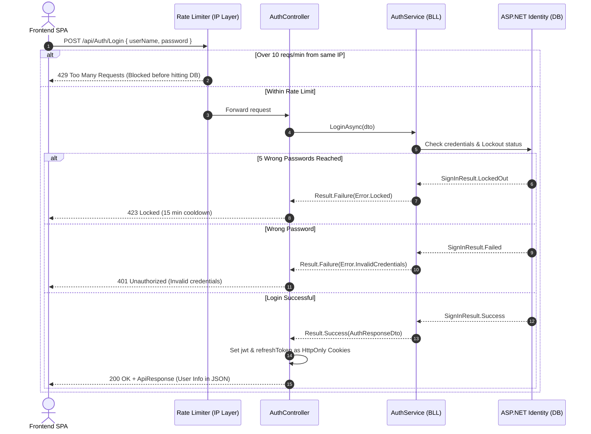

---

### Security Mechanisms Explained

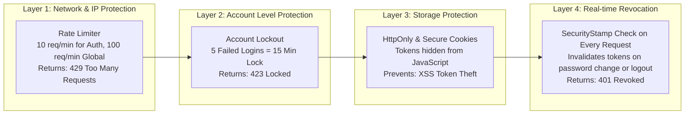

1. **`HttpOnly, Secure, SameSite=None` Cookies:**
   - Access and Refresh tokens are delivered via `Set-Cookie` headers.
   - JavaScript cannot access them, eliminating the risk of session theft via XSS.
2. **Dual-Tier Rate Limiting (`Microsoft.AspNetCore.RateLimiting`):**
   - **Global Policy:** 100 requests/minute per client IP (Sliding Window).
   - **Auth Policy (`AuthLimiter`):** 10 requests/minute per client IP (Fixed Window) on sensitive endpoints (`Login`, `Register`).
3. **Automatic Account Lockout:**
   - Configured in [DAL/DependencyInjection.cs](file:///c:/Users/norhan/source/repos/Backend_Template/DAL/DependencyInjection.cs): 5 failed password attempts locks the account for 15 minutes.
   - After 15 minutes pass, logging in with the correct password resets the failed count back to 0.
4. **Real-time Security Stamp Invalidation (`OnTokenValidated`):**
   - Every request validates the `SecurityStamp` claim against the database.
   - Changing password or logging out updates the user's `SecurityStamp`, **instantly killing all active sessions** across all devices.
5. **Username Validation & Allowed Characters (`options.User.AllowedUserNameCharacters`):**
   - **The Default Behavior:** ASP.NET Core Identity defaults to a strict whitelist: `"abcdefghijklmnopqrstuvwxyzABCDEFGHIJKLMNOPQRSTUVWXYZ0123456789-._@+"`. Notice that **spaces (`' '`) are not allowed by default**.
   - **The Login Gotcha (Refresh Tokens & `UpdateAsync`):**
     * When a user logs in successfully, `AuthService.LoginAsync` generates a Refresh Token and calls `await _userManager.UpdateAsync(user)`.
     * `UpdateAsync` triggers the full `UserValidator`. If the user's username has a space (e.g. seeded as `"Mo admin"` or `"It Admin"`), **login will suddenly fail with:**
       `UserManager.UpdateAsync failed: InvalidUserName: Username 'Mo Admin' is invalid, can only contain letters or digits.`
   - **Configuration Solutions:**
     * *Option A (Allow Spaces & Arabic Characters):* Configure in [DAL/DependencyInjection.cs](file:///c:/Users/norhan/source/repos/Backend_Template/DAL/DependencyInjection.cs):
       ```csharp
       options.User.AllowedUserNameCharacters = "abcdefghijklmnopqrstuvwxyzABCDEFGHIJKLMNOPQRSTUVWXYZ0123456789-._@+ ";
       // Or allow full Unicode / Arabic:
       options.User.AllowedUserNameCharacters = null!;
       ```
     * *Option B (Recommended Best Practice):* Keep `UserName` clean without spaces for login identifiers (e.g. `"GS1001"` or `"nour.farid"`), and store the full display name with spaces in `FullName` (`"Nour Farid"`).

### 6. Refresh Token Flow (Silent Session Refresh)

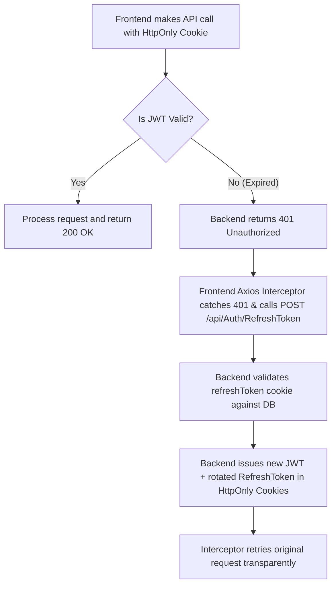

* **Anonymous Endpoint:** `POST /api/Auth/RefreshToken` does not require an active JWT (`[Authorize]` is omitted) so expired sessions can refresh seamlessly.
* **Automatic Cookie Delivery:** Tokens are read directly from `Request.Cookies` and updated via `Response.Cookies.Append`, keeping tokens hidden from browser JavaScript.

---

## 3. Data Access, Specifications & Pagination Architecture

### The Problem
* Copy-pasting `PageIndex`, `PageSize`, and `MaxPageSize` across 10+ query parameter classes.
* Creating duplicate `*CountSpecifications` classes for every entity just to count total items, which causes bugs when filters get out of sync.
* Unnecessary memory consumption when querying read-only data with EF Core tracking enabled.

---

### The Solution: Base Specifications with Auto-Stripped Pagination

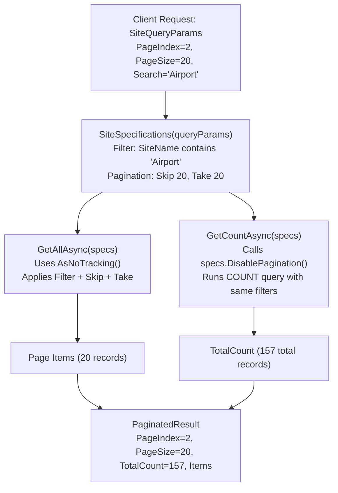

---

### Code Comparison: Before vs. After

#### A. Query Parameters
```csharp
// ❌ BEFORE: 30 lines copy-pasted in every QueryParams file
public class SiteQueryParams
{
    public string? Search { get; set; }
    private int _pageIndex = 1;
    public int PageIndex { get => _pageIndex; set => _pageIndex = (value < 1) ? 1 : value; }
    private const int MaxPageSize = 100;
    private int _pageSize = 10;
    public int PageSize { get => _pageSize; set => _pageSize = value > MaxPageSize ? MaxPageSize : value; }
}

// ✅ AFTER: Inherits clean base class
public class SiteQueryParams : BaseQueryParams
{
    public string? Search { get; set; }
}
```

#### B. Service Query & Count Handling
```csharp
// ❌ BEFORE: Two separate spec classes (filter duplication & bug-prone)
var specs = new UserSpecifications(queryParams, userIdsInRole);
var countSpecs = new UserCountSpecifications(queryParams, userIdsInRole); // Redundant class

var users = await _unitOfWork.Users.GetAllAsync(specs);
var total = await _unitOfWork.Users.GetCountAsync(countSpecs);

// ✅ AFTER: Single spec instance reused (GetCount auto-strips pagination)
var specs = new UserSpecifications(queryParams, userIdsInRole);

var users = await _unitOfWork.Users.GetAllAsync(specs); // Paginated (Skip/Take)
var total = await _unitOfWork.Users.GetCountAsync(specs); // Auto-strips Skip/Take for COUNT(*)
```

---

### Memory & Performance: `AsNoTracking()` vs Tracking

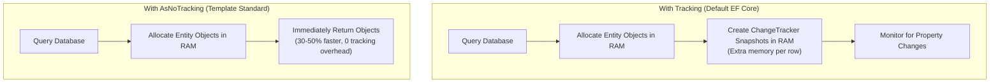

* **Read / List Queries (`GetAllAsync`):** Queries execute with `_entities.AsNoTracking()`.
* **Update Queries (`GetByIdAsync` for edit):** Tracked entity is fetched, modified, and saved via `SaveChangesAsync()`.

---

## 4. Unit of Work & Repository Pattern

### When to Use What

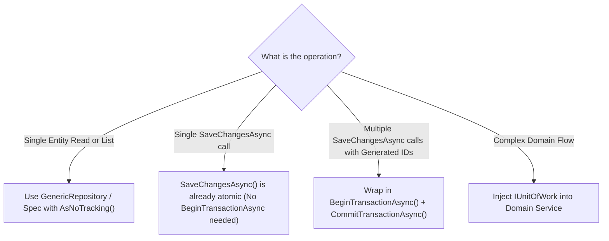

### The Transaction Golden Rule

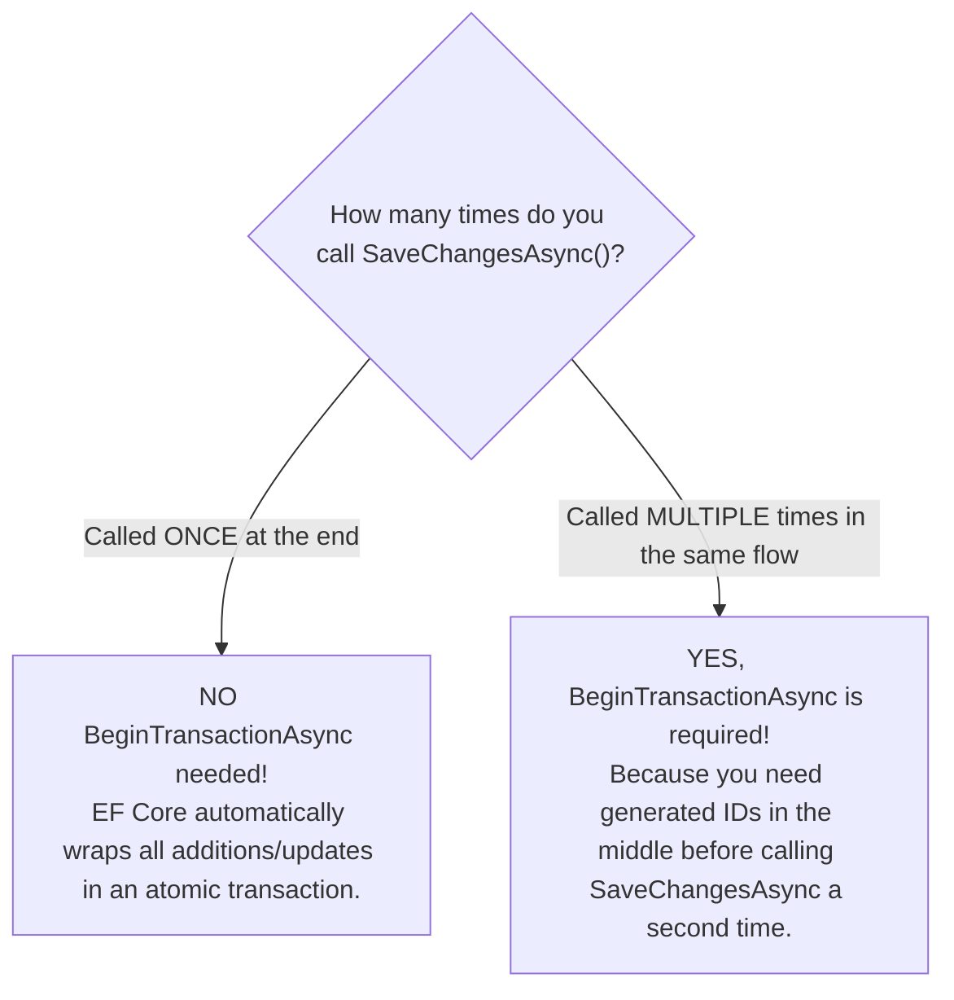

| Situation | `BeginTransactionAsync()` Needed? | Why? |
| :--- | :--- | :--- |
| **Adding 1 entity** | ❌ **No** | Handled in a single `SaveChangesAsync()` call. |
| **Adding 5 entities across 5 different tables** | ❌ **No** | A single `SaveChangesAsync()` call at the end is **already atomic** across all tables. |
| **Parent Entity + Dependent Child using generated ID** | ✅ **Yes** | Requires calling `SaveChangesAsync()` twice (once to get Parent ID, once for Child). |

---

### Scenario 1: Pure Read Query (GET / Search / List)
**Why we use it:** Unit of Work is used as a single unified access point for repositories, and `AsNoTracking()` is enforced to prevent wasting memory on tracking snapshots.

```csharp
public async Task<Result<PaginatedResult<UserDto>>> GetAllAsync(UserQueryParams queryParams)
{
    // 1. Build specification with filtering and pagination
    var specs = new UserSpecifications(queryParams);

    // 2. Fetch data without tracking overhead (AsNoTracking)
    var users = await _unitOfWork.Users.GetAllAsync(specs);

    // 3. Count total items using the same spec (auto-strips pagination)
    var totalCount = await _unitOfWork.Users.GetCountAsync(specs);

    // 4. Map to DTOs and return envelope
    var dtoList = _mapper.Map<List<UserDto>>(users);
    return new PaginatedResult<UserDto>(queryParams.PageIndex, queryParams.PageSize, totalCount, dtoList);
}
```

---

### Scenario 2: Multi-Table Atomic Write (Unrelated Entities — Single `SaveChangesAsync`)
**Why we use it:** When creating or modifying entities across multiple tables that do not depend on newly generated IDs. Because you only call `SaveChangesAsync()` **once**, EF Core automatically wraps all operations in an atomic transaction — **no `BeginTransactionAsync()` is needed!**

```csharp
public async Task<Result> AssignUserToSiteWithAuditAsync(string userId, int siteId, string assignedBy)
{
    // Step 1: Stage the User-Site assignment
    var userSite = new UserSite { UserId = userId, SiteId = siteId };
    await _unitOfWork.Repository<UserSite>().AddAsync(userSite);

    // Step 2: Stage the Audit Log entry
    var auditLog = new LogEquipment { UserId = assignedBy, Action = "UserSiteAssignment", Timestamp = DateTime.UtcNow };
    await _unitOfWork.Repository<LogEquipment>().AddAsync(auditLog);

    // Step 3: Single SaveChangesAsync — EF Core automatically wraps both in 1 atomic transaction!
    await _unitOfWork.SaveChangesAsync();

    return Result.Success();
}
```

---

### Scenario 3: Explicit Transaction with Generated ID (Multiple `SaveChangesAsync` Calls)
**Why we use it:** When Child Entity B strictly requires the database-generated Identity ID of Parent Entity A before it can be created. Because you must call `SaveChangesAsync()` **twice**, an explicit `BeginTransactionAsync()` is required so both saves share the same transaction.

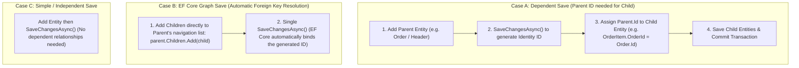

#### Case A: Explicit ID Propagation within a Transaction
When child records are handled by separate repositories and need the parent's generated primary key:

```csharp
public async Task<Result<int>> CreateOrderWithPaymentAsync(CreateOrderDto dto)
{
    await _unitOfWork.BeginTransactionAsync();
    try
    {
        // 1. Create and save the Parent entity to generate its database ID
        var order = new Order { CustomerId = dto.CustomerId, TotalAmount = dto.TotalAmount };
        await _unitOfWork.Repository<Order>().AddAsync(order);
        await _unitOfWork.SaveChangesAsync(); // <-- order.Id is now populated by SQL Server!

        // 2. Use the newly generated order.Id for dependent payment and items
        var payment = new Payment 
        { 
            OrderId = order.Id, // <-- Generated ID from step 1
            Amount = dto.TotalAmount, 
            Status = "Completed" 
        };
        await _unitOfWork.Repository<Payment>().AddAsync(payment);

        // 3. Commit the entire transaction
        await _unitOfWork.CommitTransactionAsync();
        return order.Id;
    }
    catch
    {
        await _unitOfWork.RollbackTransactionAsync();
        return Error.Failure("Order.CreationFailed", "Could not complete order creation.");
    }
}
```

#### Case B: EF Core Entity Graph (Automatic Foreign Key Binding)
If parent and children are part of the same entity navigation property:
```csharp
var order = new Order
{
    CustomerId = dto.CustomerId,
    OrderItems = dto.Items.Select(i => new OrderItem { ProductName = i.Name, Price = i.Price }).ToList()
};

// EF Core automatically generates the Order ID and assigns it to each OrderItem in a single SaveChanges call
await _unitOfWork.Repository<Order>().AddAsync(order);
await _unitOfWork.SaveChangesAsync();
```

#### Case C: Simple Independent Save
When saving an isolated entity without relational dependencies:
```csharp
var site = new Site { Name = dto.Name, Code = dto.Code };
await _unitOfWork.Repository<Site>().AddAsync(site);
await _unitOfWork.SaveChangesAsync();
```

### Scenario 4: Single Entity Update (Tracked vs. Direct Execution)

#### Approach A: Tracked Update (For standard domain updates)
```csharp
// 1. Fetch tracked entity
var user = await _unitOfWork.Users.GetByIdAsync(dto.UserId);
if (user == null)
    return Error.NotFound("User.NotFound", "User not found.");

// 2. Modify properties
user.FullName = dto.FullName;
user.Email = dto.Email;

// 3. SaveChanges (EF Core change tracker generates SQL updating ONLY the modified columns)
await _unitOfWork.SaveChangesAsync();
```

#### Approach B: Direct SQL Update (For high-throughput or bulk updates without memory allocation)
```csharp
await _context.Users
    .Where(u => u.Id == dto.UserId)
    .ExecuteUpdateAsync(s => s
        .SetProperty(u => u.FullName, dto.FullName)
        .SetProperty(u => u.Email, dto.Email));
```

---

## 5. Standardized Response & Error Handling

### The Problem: The "5 Chaotic Response Formats" (Frontend Nightmare)

Before adopting the Unified Response Envelope, frontend developers had to write massive parsing helpers (e.g. `extractErrorMessage`) containing complex if-else ladders because different parts of ASP.NET Core returned **5 completely inconsistent error formats**:

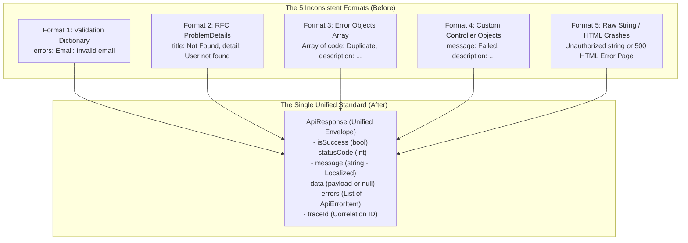

#### The 5 Inconsistent Formats Detailed:

| Format # | Where It Came From | What It Looked Like | Why It Was A Problem for Frontend |
| :--- | :--- | :--- | :--- |
| **1. Validation Dictionary** | Default ASP.NET Core `[ApiController]` model binding. | `{ "errors": { "UserName": ["Required"], "Email": ["Invalid"] } }` | Object with dynamic keys. Hard to extract a single user-friendly message. |
| **2. ProblemDetails** | Built-in framework exceptions / RFC 7807. | `{ "type": "...", "title": "Not Found", "status": 404, "detail": "Site not found" }` | Message is split between `title` and `detail`. Inconsistent across endpoints. |
| **3. Identity Error Array** | `IdentityResult.Errors` collection. | `[ { "code": "PasswordTooShort", "description": "Password must be 6+ chars" } ]` | Root response is a raw array instead of an object. Breaks `response.data.someField`. |
| **4. Custom Controller Objects** | Ad-hoc controller responses written by different devs. | `{ "message": "Done", "status": 200 }` or `{ "description": "Failed" }` | Unpredictable property names (`message` vs `description` vs `msg`). |
| **5. Raw String / 500 HTML** | Middleware crashes or `return BadRequest("Invalid")`. | `"Unauthorized access"` or `<html><body>Internal Server Error...</body></html>` | Not valid JSON or raw primitives. Causes JSON parser crashes on frontend. |

---

### The Solution: Unified `ApiResponse<T>` Anatomy

Every single endpoint — whether Success or Error, 200, 400, 401, 403, 404, 423, 429, or 500 — returns the exact same envelope defined in [ApiResponse.cs](file:///c:/Users/norhan/source/repos/Backend_Template/Shared/DTO/ApiResponse.cs):

```json
// 1. Standard Success Response (200 OK)
{
  "isSuccess": true,
  "statusCode": 200,
  "message": "User retrieved successfully",
  "data": {
    "userId": "usr_101",
    "userName": "GS1234",
    "fullName": "Ahmed Ali",
    "role": "Admin"
  },
  "errors": [],
  "traceId": ""
}

// 2. Standard Error Response (400 / 401 / 403 / 404 / 423 / 429 / 500)
{
  "isSuccess": false,
  "statusCode": 400,
  "message": "Username is required | Email is invalid",
  "data": null,
  "errors": [
    {
      "code": "UserName",
      "description": "Username is required",
      "type": "Validation"
    },
    {
      "code": "Email",
      "description": "Email is invalid",
      "type": "Validation"
    }
  ],
  "traceId": "0HN81B7GF4:00000001"
}
```

### Why the Frontend Loves This:
1. **Zero Guesswork:** The frontend always reads `response.data.data` for payload and `response.data.message` for UI toasts/alerts.
2. **Always Localized:** `message` is already translated on the server based on the client's `Accept-Language` header (Arabic or English).
3. **Structured Form Validation:** Frontend form validators can map `errors[i].code` directly to form input fields.

---

### How the Backend Automatically Enforces This

1. **Controller Actions:** Inherit from [ApiBaseController.cs](file:///c:/Users/norhan/source/repos/Backend_Template/API/Controllers/ApiBaseController.cs) (`HandleSuccess`, `HandleMessage`, `HandleResult`, `HandleError`).
2. **Model Validation Override:** In [Program.cs](file:///c:/Users/norhan/source/repos/Backend_Template/API/Program.cs#L28-L52), `InvalidModelStateResponseFactory` intercepts model binding errors and wraps them into `ApiResponse<object>.Fail`.
3. **Unhandled Exceptions:** [ExceptionHandlingMiddleware.cs](file:///c:/Users/norhan/source/repos/Backend_Template/API/Middleware/ExceptionHandlingMiddleware.cs) catches database crashes and server faults, translating them into `ApiResponse<object>.Fail` with status 500.

### 5. Flexible Controller Response Handling (`HandleRequest`)

#### Why We Made This Change: The 3 Inflexibility Pain Points

Before this update, controllers were constrained by rigid, inflexible handling mechanisms:

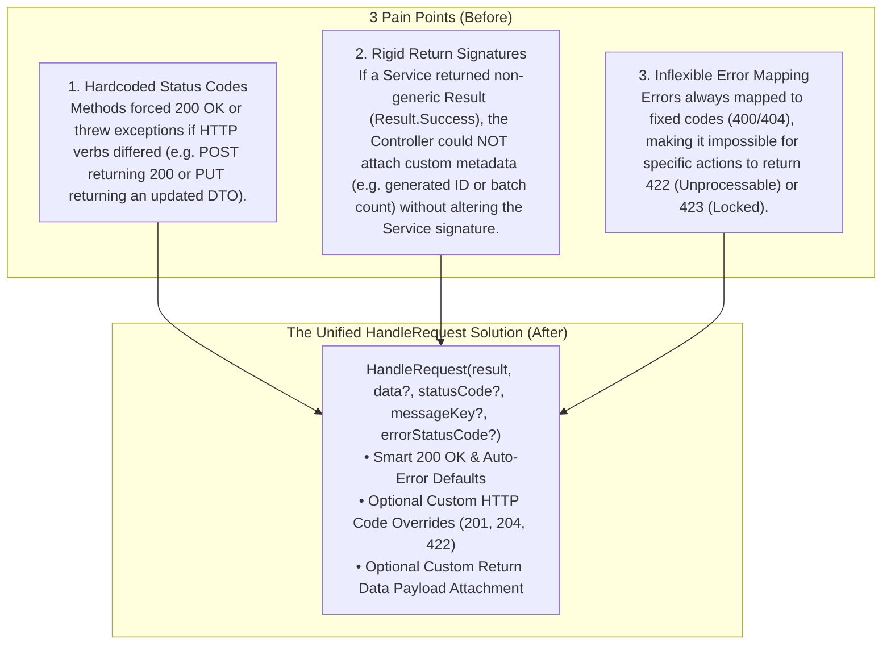

---

#### Before vs. After Code Comparison

##### A. In `ApiBaseController.cs`

```csharp
// ❌ BEFORE: Rigid switch statement or multiple restricted overloads
protected IActionResult HandleResult(Result result, string? successMessageKey = null)
{
    // Hardcoded to 200 OK. No way to pass 201 Created or custom returned objects!
    if (result.IsSuccess) return HandleMessage(successMessageKey);
    return MapErrorsToResponse(result.Errors);
}

// ✅ AFTER: Unified HandleRequest with smart defaults, optional overrides, 204 NoContent support, and HandleError helper
protected IActionResult HandleRequest(
    Result result, 
    object? data = null, 
    int statusCode = StatusCodes.Status200OK, 
    string? successMessageKey = null, 
    int? errorStatusCode = null)
{
    if (result.IsFailure)
        return MapErrorsToResponse(result.Errors, errorStatusCode);

    if (statusCode == StatusCodes.Status204NoContent)
        return NoContent(); // Returns empty HTTP 204 body per RFC standards

    string? message = null;
    if (!string.IsNullOrEmpty(successMessageKey))
    {
        var localized = Localizer[successMessageKey];
        message = (!localized.ResourceNotFound && !string.IsNullOrEmpty(localized.Value))
            ? localized.Value
            : successMessageKey;
    }

    var payload = data ?? result.GetType().GetProperty("Value")?.GetValue(result);

    return StatusCode(statusCode, ApiResponse<object>.Ok(payload, message, statusCode));
}

// Direct localized ad-hoc error helper for controllers:
protected IActionResult HandleError(string code, string fallbackDescription, int statusCode = StatusCodes.Status400BadRequest)
{
    var localized = Localizer[code];
    var desc = (!localized.ResourceNotFound && !string.IsNullOrEmpty(localized.Value))
        ? localized.Value
        : fallbackDescription;

    var errorItem = new ApiErrorItem(code, desc, "Error");
    var response = ApiResponse<object>.Fail(desc, [errorItem], statusCode);
    return StatusCode(statusCode, response);
}
```

##### B. In Derived Controllers

```csharp
// ❌ BEFORE: Verbose if-checks or inability to attach custom data
[HttpPost("import")]
public async Task<IActionResult> Import(List<ItemDto> items)
{
    var result = await _service.ImportAsync(items);
    if (result.IsFailure) return HandleResult(result);
    // Had to manually construct custom ApiResponse wrapper if returning data with non-generic Result:
    return StatusCode(201, ApiResponse<object>.Ok(new { Total = items.Count }, "Import.Success", 201));
}

// ✅ AFTER: One clean, expressive line with named arguments
[HttpPost("import")]
public async Task<IActionResult> Import(List<ItemDto> items)
{
    var result = await _service.ImportAsync(items);
    return HandleRequest(result, data: new { Total = items.Count }, statusCode: StatusCodes.Status201Created, successMessageKey: "Import.Success");
}
```

---

#### Status Code Resolution Strategy

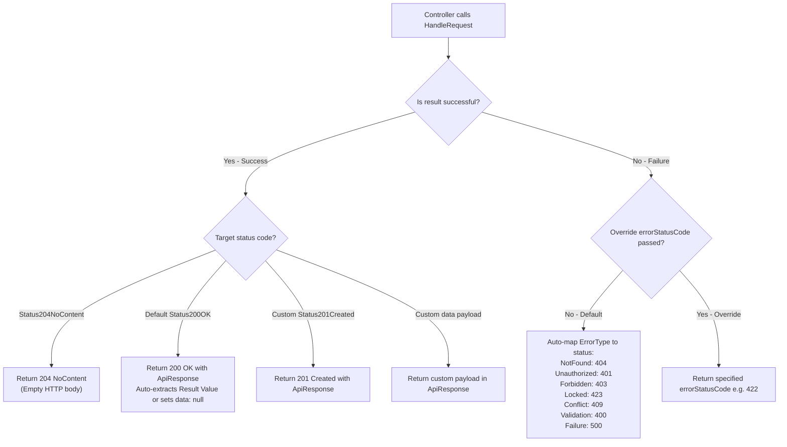

---

#### Practical Usage Scenarios Matrix

| Scenario | Code Example | Returned HTTP Code & Payload |
| :--- | :--- | :--- |
| **1. Standard Query (Default 200)** | `return HandleRequest(result);` | `200 OK` with payload |
| **2. Create with `200 OK` (No Data)** | `return HandleRequest(result, successMessageKey: "User.CreateSuccess");` | `200 OK` with `data: null` & localized message |
| **3. Delete / Action with `204 NoContent`** | `return HandleRequest(result, statusCode: StatusCodes.Status204NoContent);` | `204 No Content` (*Empty body*) |
| **4. Resource Creation (201 Created)** | `return HandleRequest(result, statusCode: StatusCodes.Status201Created, successMessageKey: "User.CreateSuccess");` | `201 Created` with payload |
| **5. Non-Generic Result with Custom Object** | `return HandleRequest(result, data: new { id = entity.Id }, statusCode: 201);` | `201 Created` with `{ id }` payload |
| **6. Custom Error Code Override** | `return HandleRequest(result, errorStatusCode: StatusCodes.Status422UnprocessableEntity);` | `422 Unprocessable Entity` with localized errors |
| **7. Ad-Hoc Localized Error (`HandleError`)** | `return HandleError("File.InvalidExtension", "Only .png allowed", 400);` | `400 Bad Request` with localized `ApiResponse` |

```csharp
// Example Controller showcasing all scenarios:
[ApiController]
[Route("api/[controller]")]
public class ProductsController : ApiBaseController
{
    // Pattern 1: Pure default (200 OK with Result<T>)
    [HttpGet("{id}")]
    public async Task<IActionResult> GetById(int id)
    {
        var result = await _productService.GetByIdAsync(id);
        return HandleRequest(result);
    }

    // Pattern 2: 200 OK with success message and data: null (e.g. for User Add)
    [HttpPost("add")]
    public async Task<IActionResult> Add(NewUserDto dto)
    {
        var result = await _userService.CreateAsync(dto, CurrentUserId);
        return HandleRequest(result, successMessageKey: "User.CreateSuccess");
    }

    // Pattern 3: 204 No Content on delete (empty body)
    [HttpDelete("{id}")]
    public async Task<IActionResult> Delete(int id)
    {
        var result = await _productService.DeleteAsync(id);
        return HandleRequest(result, statusCode: StatusCodes.Status204NoContent);
    }

    // Pattern 4: Result<T> with custom 201 Created status code & localized message
    [HttpPost]
    public async Task<IActionResult> Create(CreateProductDto dto)
    {
        var result = await _productService.CreateAsync(dto);
        return HandleRequest(result, statusCode: StatusCodes.Status201Created, successMessageKey: "Product.CreateSuccess");
    }

    // Pattern 5: Non-generic Result + custom returned object (optional)
    [HttpPost("import")]
    public async Task<IActionResult> ImportBatch(List<CreateProductDto> dtos)
    {
        var result = await _productService.ImportBatchAsync(dtos);
        return HandleRequest(result, data: new { TotalImported = dtos.Count }, statusCode: StatusCodes.Status201Created);
    }

    // Pattern 6: Explicit Error Status Code override (e.g. 422 Unprocessable Entity)
    [HttpPost("process")]
    public async Task<IActionResult> ProcessOrder(ProcessOrderDto dto)
    {
        var result = await _orderService.ProcessAsync(dto);
        return HandleRequest(result, errorStatusCode: StatusCodes.Status422UnprocessableEntity);
    }

    // Pattern 7: Direct localized error without calling domain service (e.g. file validation)
    [HttpPost("upload")]
    public IActionResult UploadFile(IFormFile file)
    {
        if (file.Length > 5 * 1024 * 1024)
            return HandleError("File.TooLarge", "File exceeds 5MB limit", StatusCodes.Status400BadRequest);

        return HandleRequest(Result.Success());
    }
}
```

---

## 6. Multi-Language Localization (i18n) & Error Fallback System

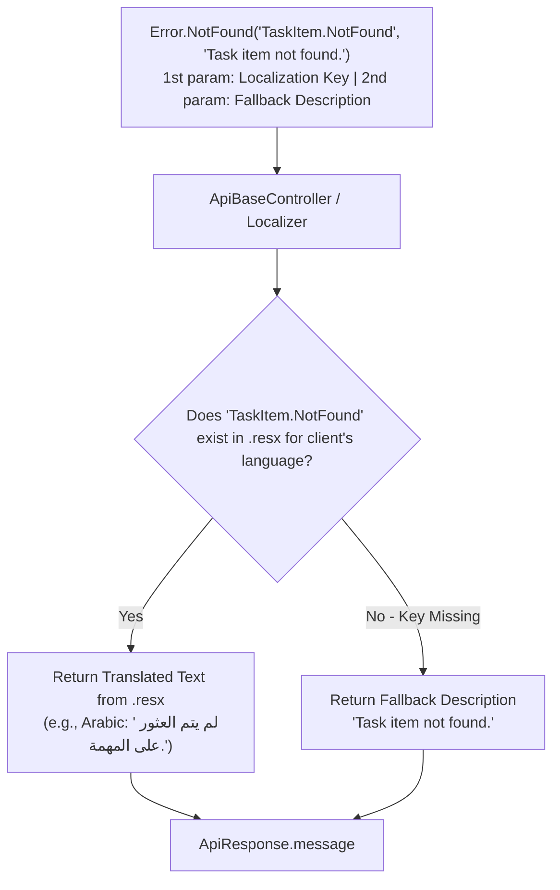

### Why Every `Error` Has a Fallback Parameter:
1. **Zero-Crash Resilience:** If a developer creates a new error code but forgets to add the key to `Messages.resx` / `Messages.ar.resx`, the API will **never return an empty string or crash**. It safely outputs the fallback English text.
2. **Localization First:** When the key is registered in `.resx`, the translated value automatically takes precedence based on the `Accept-Language` header (`ar` / `en`).
3. **In-Code Documentation:** Reading `Error.Validation("User.InvalidCode", "Employee code must be a positive number.")` in C# immediately tells the developer what the error means without having to open the `.resx` XML file.

* **Resource Files:** [Messages.resx](file:///c:/Users/norhan/source/repos/Backend_Template/BLL/Resources/Messages.resx) (English) and [Messages.ar.resx](file:///c:/Users/norhan/source/repos/Backend_Template/BLL/Resources/Messages.ar.resx) (Arabic).
* **Automatic Resolution:** `ApiBaseController` and `ExceptionHandlingMiddleware` automatically look up error codes in the caller's culture based on the `Accept-Language` header.

---

## 7. Developer Blueprint: Adding a New Entity (Step-by-Step Tutorial)

This masterclass tutorial demonstrates how to add a brand-new entity from scratch — from database models to controllers — using an example entity **`TaskItem`** which has a relationship to the **`User`** entity.

### Complete Architecture Pipeline

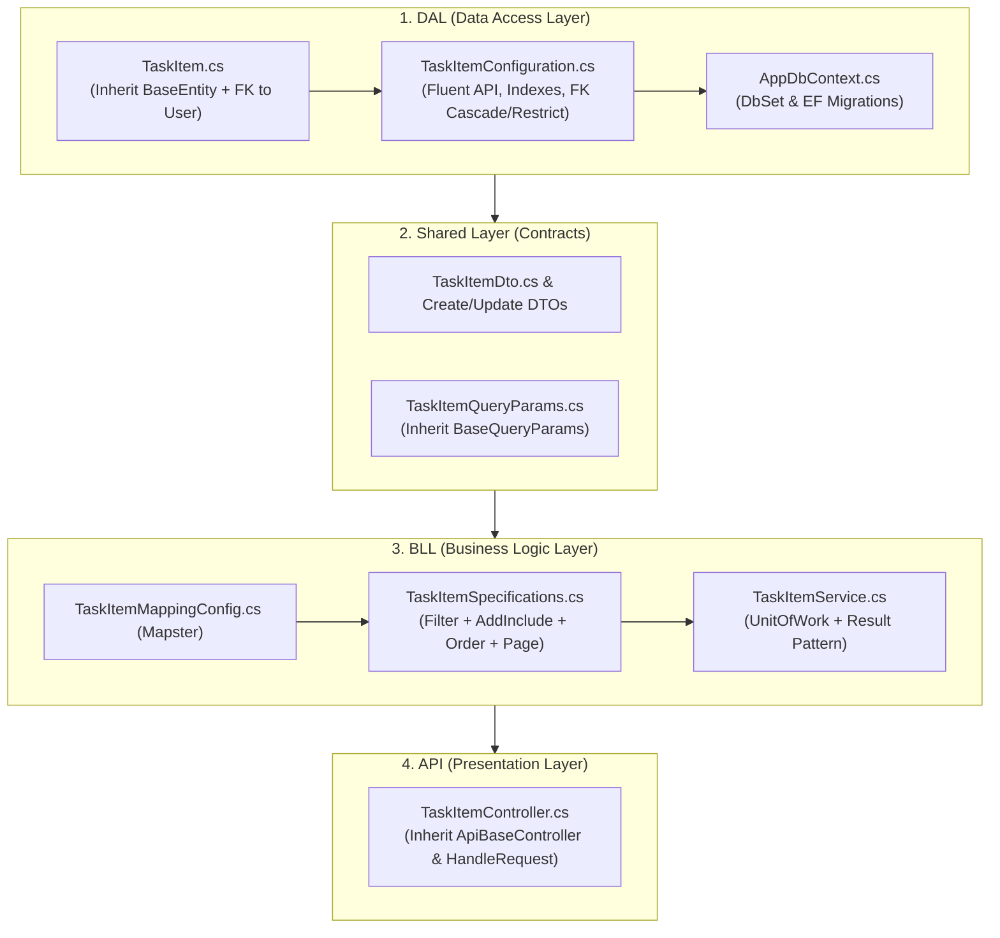

---

### Step 1: DAL (Data Access Layer)

#### 1.1 Create the Entity Model (`DAL/Model/TaskItem.cs`)
Inherit from `BaseEntity` (which provides `Id`, `CreatedAt`, `UpdatedAt`) and establish the foreign key relationship to `User`:

```csharp
namespace DAL.Model;

public class TaskItem : BaseEntity
{
    public string Title { get; set; } = string.Empty;
    public string Description { get; set; } = string.Empty;
    public string Status { get; set; } = "Pending"; // Pending, InProgress, Completed
    public DateTime? DueDate { get; set; }

    // Relationship with User (Assigned User)
    public string UserId { get; set; } = string.Empty;
    public virtual User User { get; set; } = null!;
}
```

#### 1.2 Create the EF Core Configuration (`DAL/Configurations/TaskItemConfiguration.cs`)
Configure table name, property constraints, database indexes for fast query performance, and the foreign key delete behavior:

```csharp
using DAL.Model;
using Microsoft.EntityFrameworkCore;
using Microsoft.EntityFrameworkCore.Metadata.Builders;

namespace DAL.Configurations;

public class TaskItemConfiguration : IEntityTypeConfiguration<TaskItem>
{
    public void Configure(EntityTypeBuilder<TaskItem> builder)
    {
        builder.ToTable("TaskItems");

        builder.Property(t => t.Title)
            .IsRequired()
            .HasMaxLength(200);

        builder.Property(t => t.Description)
            .HasMaxLength(1000);

        builder.Property(t => t.Status)
            .IsRequired()
            .HasMaxLength(50);

        // Foreign Key Relationship to User
        builder.HasOne(t => t.User)
            .WithMany()
            .HasForeignKey(t => t.UserId)
            .OnDelete(DeleteBehavior.Restrict); // Prevent cascading delete from deleting users

        // Performance Indexes for fast filtering & search
        builder.HasIndex(t => t.UserId);
        builder.HasIndex(t => t.Status);
        builder.HasIndex(t => t.Title);
    }
}
```

#### 1.3 Register `DbSet` in `AppDbContext.cs`
Add the entity's `DbSet` to [DAL/Context/AppDbContext.cs](file:///c:/Users/norhan/source/repos/Backend_Template/DAL/Context/AppDbContext.cs):

```csharp
public DbSet<TaskItem> TaskItems { get; set; }
```
*(Configurations in the same assembly are automatically applied via `modelBuilder.ApplyConfigurationsFromAssembly`.)*

#### 1.4 Generate EF Core Migration
Run the following CLI command in the terminal to create the database table:
```bash
dotnet ef migrations add AddTaskItemEntity --project DAL --startup-project API
dotnet ef database update --project DAL --startup-project API
```

---

### Step 2: Shared Layer (DTOs & Query Parameters)

#### 2.1 Create DTOs (`Shared/DTO/TaskItemDtos/TaskItemDto.cs`)
Define the payload structures for API responses and client requests:

```csharp
namespace Shared.DTO.TaskItemDtos;

public class TaskItemDto
{
    public int Id { get; set; }
    public string Title { get; set; } = string.Empty;
    public string Description { get; set; } = string.Empty;
    public string Status { get; set; } = string.Empty;
    public DateTime? DueDate { get; set; }
    public DateTime CreatedAt { get; set; }

    // User Relationship metadata
    public string UserId { get; set; } = string.Empty;
    public string UserFullName { get; set; } = string.Empty;
    public string UserCode { get; set; } = string.Empty;
}

public class CreateTaskItemDto
{
    public string Title { get; set; } = string.Empty;
    public string Description { get; set; } = string.Empty;
    public DateTime? DueDate { get; set; }
    public string? UserId { get; set; } // Optional: assign to specific user or current user
}

public class UpdateTaskItemDto
{
    public string Title { get; set; } = string.Empty;
    public string Description { get; set; } = string.Empty;
    public string Status { get; set; } = string.Empty;
    public DateTime? DueDate { get; set; }
}
```

#### 2.2 Create Query Parameters (`Shared/SpecificationsQueryParams/TaskItemQueryParams.cs`)
Inherit from `BaseQueryParams` which already provides `PageIndex`, `PageSize`, `Search`, `Sort`, and `IsAscending` (`bool`). Only define entity-specific filters:

```csharp
namespace Shared.SpecificationsQueryParams;

public class TaskItemQueryParams : BaseQueryParams
{
    // Specific domain filters only (Search, Sort, and Pagination are already inherited!)
    public string? Status { get; set; }
    public string? UserId { get; set; }
}
```

---

### Step 3: BLL (Business Logic Layer)

#### 3.1 Mapping Configuration (`BLL/Mapping/TaskItemMappingConfig.cs`)
Implement Mapster's `IRegister` interface (automatically discovered via assembly scanning in `BLL/DependencyInjection.cs`):

```csharp
using DAL.Model;
using Mapster;
using Shared.DTO.TaskItemDtos;

namespace BLL.Mapping;

public class TaskItemMappingConfig : IRegister
{
    public void Register(TypeAdapterConfig config)
    {
        config.NewConfig<TaskItem, TaskItemDto>()
            .Map(dest => dest.UserFullName, src => src.User.FullName)
            .Map(dest => dest.UserCode, src => src.User.UserCode);

        config.NewConfig<CreateTaskItemDto, TaskItem>();
        config.NewConfig<UpdateTaskItemDto, TaskItem>();
    }
}
```

#### 3.2 Create Specification Class (`BLL/Specifications/TaskItemSpecifications/TaskItemSpecifications.cs`)
Encapsulate filtering, eager-loading related `User`, dynamic sorting with `Sort` and `IsAscending`, and pagination in a single spec:

```csharp
using BLL.Specifications;
using DAL.Model;
using Shared.SpecificationsQueryParams;

namespace BLL.Specifications.TaskItemSpecifications;

public class TaskItemSpecifications : BaseSpecifications<TaskItem>
{
    public TaskItemSpecifications(TaskItemQueryParams queryParams)
        : base(t =>
            (string.IsNullOrWhiteSpace(queryParams.Search) || t.Title.ToLower().Contains(queryParams.Search.ToLower()) || t.Description.ToLower().Contains(queryParams.Search.ToLower()))
            && (string.IsNullOrWhiteSpace(queryParams.Status) || t.Status.ToLower() == queryParams.Status.ToLower())
            && (string.IsNullOrWhiteSpace(queryParams.UserId) || t.UserId == queryParams.UserId))
    {
        // 1. Eager load the related User entity
        AddInclude(t => t.User);

        // 2. Apply Dynamic Sorting using BaseQueryParams Sort and IsAscending
        if (!queryParams.IsAscending)
        {
            switch (queryParams.Sort?.ToLower())
            {
                case "title": AddOrderByDescending(t => t.Title); break;
                case "duedate": AddOrderByDescending(t => t.DueDate ?? DateTime.MinValue); break;
                default: AddOrderByDescending(t => t.CreatedAt); break;
            }
        }
        else
        {
            switch (queryParams.Sort?.ToLower())
            {
                case "title": AddOrderBy(t => t.Title); break;
                case "duedate": AddOrderBy(t => t.DueDate ?? DateTime.MaxValue); break;
                default: AddOrderBy(t => t.CreatedAt); break;
            }
        }

        // 3. Apply Pagination (Skip / Take)
        ApplyPagination(queryParams.PageSize, queryParams.PageIndex);
    }
}
```

#### 3.3 Create Service Implementation (`BLL/Services/TaskItemService.cs`)
Implement the service directly using `IUnitOfWork`, **Mapster `.Adapt<T>()`** (clean syntax without injecting `IMapper` into constructors), and railway-oriented `Result<T>`:

```csharp
using BLL.CommonResult;
using BLL.Specifications.TaskItemSpecifications;
using DAL.Interfaces;
using DAL.Model;
using Mapster;
using Shared.DTO;
using Shared.DTO.TaskItemDtos;
using Shared.SpecificationsQueryParams;

namespace BLL.Services;

public class TaskItemService
{
    private readonly IUnitOfWork _unitOfWork;

    public TaskItemService(IUnitOfWork unitOfWork)
    {
        _unitOfWork = unitOfWork;
    }

    public async Task<Result<PaginatedResult<TaskItemDto>>> GetAllAsync(TaskItemQueryParams queryParams)
    {
        var specs = new TaskItemSpecifications(queryParams);

        // 1. Fetch paginated records with AsNoTracking and eager-loaded User
        var tasks = await _unitOfWork.Repository<TaskItem>().GetAllAsync(specs);

        // 2. Count total items reusing the same spec (GetCountAsync auto-strips Skip/Take)
        var totalCount = await _unitOfWork.Repository<TaskItem>().GetCountAsync(specs);

        // 3. Fast Mapster projection via extension method (.Adapt)
        var dtoList = tasks.Adapt<List<TaskItemDto>>();

        return new PaginatedResult<TaskItemDto>(queryParams.PageIndex, queryParams.PageSize, totalCount, dtoList);
    }

    public async Task<Result<TaskItemDto>> GetByIdAsync(int id)
    {
        var task = await _unitOfWork.Repository<TaskItem>().GetByIdAsync(id);
        if (task == null)
            // 1st param: Localization key for Messages.resx / Messages.ar.resx
            // 2nd param: Fallback English description (used if key is missing in .resx, preventing crashes)
            return Error.NotFound("TaskItem.NotFound", "Task item not found.");

        return task.Adapt<TaskItemDto>();
    }

    public async Task<Result<TaskItemDto>> CreateAsync(CreateTaskItemDto dto, string currentUserId)
    {
        // Direct Mapster mapping from DTO to Entity
        var task = dto.Adapt<TaskItem>();
        task.UserId = !string.IsNullOrEmpty(dto.UserId) ? dto.UserId : currentUserId;

        var created = await _unitOfWork.Repository<TaskItem>().AddAsync(task);
        return created.Adapt<TaskItemDto>();
    }

    public async Task<Result> UpdateAsync(int id, UpdateTaskItemDto dto)
    {
        var task = await _unitOfWork.Repository<TaskItem>().GetByIdAsync(id);
        if (task == null)
            return Error.NotFound("TaskItem.NotFound", "Task item not found.");

        // In-place entity property update with Mapster:
        dto.Adapt(task);
        task.UpdatedAt = DateTime.UtcNow;

        await _unitOfWork.Repository<TaskItem>().UpdateAsync(task);
        return Result.Success();
    }

    public async Task<Result> DeleteAsync(int id)
    {
        var success = await _unitOfWork.Repository<TaskItem>().DeleteAsync(id);
        if (!success)
            return Error.NotFound("TaskItem.NotFound", "Task item not found.");

        return Result.Success();
    }
}
```

#### 3.4 Automatic Dependency Injection (Zero Manual Registration)
Because [`BLL/DependencyInjection.cs`](file:///c:/Users/norhan/source/repos/Backend_Template/BLL/DependencyInjection.cs) already configures **Scrutor automatic assembly scanning** and **Mapster auto-discovery**, you write **zero lines of DI registration code**!

```csharp
// In BLL/DependencyInjection.cs (Configured once for all current & future entities):
public static IServiceCollection AddBllDependencies(this IServiceCollection services, IConfiguration configuration)
{
    // 1. JWT Configuration
    services.Configure<JwtAuthOption>(configuration.GetSection("Jwt"));

    // 2. Auto-discover all Mapster IRegister mapping files across BLL
    var mapsterConfig = TypeAdapterConfig.GlobalSettings;
    mapsterConfig.Scan(typeof(DependencyInjection).Assembly);
    services.AddSingleton(mapsterConfig);

    // 3. Auto-discover and register all *Service classes (both concrete & interfaces)
    services.Scan(scan => scan
        .FromAssemblyOf<AuthService>()
        .AddClasses(classes => classes.Where(type => type.Name.EndsWith("Service")))
        .AsSelfWithInterfaces()
        .WithScopedLifetime());

    return services;
}
```
*(Any new class ending with `Service` and any `IRegister` mapping config is automatically registered with scoped lifetime.)*

---

### Step 4: API Layer (Presentation Layer)

#### 4.1 Create Controller (`API/Controllers/TaskItemController.cs`)
Inherit from `ApiBaseController`, inject `TaskItemService` directly, and use `HandleRequest`:

```csharp
using BLL.Services;
using Microsoft.AspNetCore.Authorization;
using Microsoft.AspNetCore.Mvc;
using Shared.DTO.TaskItemDtos;
using Shared.SpecificationsQueryParams;
using System.Security.Claims;

namespace API.Controllers;

[Authorize]
[ApiController]
[Route("api/[controller]")]
public class TaskItemController : ApiBaseController
{
    private readonly TaskItemService _taskItemService;

    public TaskItemController(TaskItemService taskItemService)
    {
        _taskItemService = taskItemService;
    }

    // 1. GET /api/TaskItem?search=...&status=...&pageIndex=1&pageSize=10&sort=title&isAscending=true
    [HttpGet]
    public async Task<IActionResult> GetAll([FromQuery] TaskItemQueryParams queryParams)
    {
        var result = await _taskItemService.GetAllAsync(queryParams);
        return HandleRequest(result); // Returns 200 OK + ApiResponse<PaginatedResult<TaskItemDto>>
    }

    // 2. GET /api/TaskItem/{id}
    [HttpGet("{id}")]
    public async Task<IActionResult> GetById(int id)
    {
        var result = await _taskItemService.GetByIdAsync(id);
        return HandleRequest(result); // Returns 200 OK or 404 NotFound
    }

    // 3. POST /api/TaskItem (Creates item & returns 201 Created + Localized Toast)
    [HttpPost]
    public async Task<IActionResult> Create(CreateTaskItemDto dto)
    {
        var currentUserId = User.FindFirstValue(ClaimTypes.NameIdentifier) ?? string.Empty;
        var result = await _taskItemService.CreateAsync(dto, currentUserId);
        return HandleRequest(result, statusCode: StatusCodes.Status201Created, successMessageKey: "TaskItem.CreateSuccess");
    }

    // 4. PUT /api/TaskItem/{id} (Updates item & returns 200 with localized message)
    [HttpPut("{id}")]
    public async Task<IActionResult> Update(int id, UpdateTaskItemDto dto)
    {
        var result = await _taskItemService.UpdateAsync(id, dto);
        return HandleRequest(result, successMessageKey: "TaskItem.UpdateSuccess");
    }

    // 5. DELETE /api/TaskItem/{id} (Deletes item & returns 200 with localized message)
    [HttpDelete("{id}")]
    public async Task<IActionResult> Delete(int id)
    {
        var result = await _taskItemService.DeleteAsync(id);
        return HandleRequest(result, successMessageKey: "TaskItem.DeleteSuccess");
    }
}
```

---

### Step 5: Add Localization Keys (Optional but Recommended)
Add the success/error keys to [BLL/Resources/Messages.resx](file:///c:/Users/norhan/source/repos/Backend_Template/BLL/Resources/Messages.resx) and [Messages.ar.resx](file:///c:/Users/norhan/source/repos/Backend_Template/BLL/Resources/Messages.ar.resx):

| Resource Key | English Value (`Messages.resx`) | Arabic Value (`Messages.ar.resx`) |
| :--- | :--- | :--- |
| `TaskItem.CreateSuccess` | "Task created successfully." | "تم إنشاء المهمة بنجاح." |
| `TaskItem.UpdateSuccess` | "Task updated successfully." | "تم تحديث المهمة بنجاح." |
| `TaskItem.DeleteSuccess` | "Task deleted successfully." | "تم حذف المهمة بنجاح." |
| `TaskItem.NotFound` | "Task item was not found." | "لم يتم العثور على المهمة." |

---

## 8. Role & User-Role Management Architecture

### Problem & Design Strategy
Managing roles and user-role assignments requires balancing **database relational integrity** with **ASP.NET Core Identity string-based APIs** and **clean API contracts**:

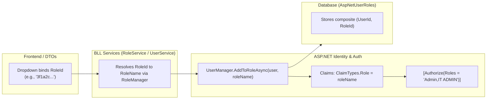

### Key Architectural Guidelines:
1. **Separation of DTOs**:
   - `Shared.DTO.RoleDtos`: Contains pure role definitions (`CreateRoleDto`, `EditRoleDto`, `RoleDetailsDto`, `RoleDto`).
   - `Shared.DTO.UserRoleDtos`: Contains user-role assignment operations (`AssignUserRoleDto`, `UpdateUserRolesDto`, `UserRoleInfoDto`).
2. **DTO Identification (`RoleId` vs `RoleName`)**:
   - DTOs accept **`RoleId`** for stable dropdown selection (protecting against role rename breaks).
   - Internal service methods resolve `RoleId` $\to$ `RoleName` before calling `_userManager.AddToRoleAsync(...)` / `_userManager.RemoveFromRolesAsync(...)`.
3. **Authorization & JWT**:
   - JWT tokens embed role names into `ClaimTypes.Role` so standard `[Authorize(Roles = "...")]` attributes work out of the box.

---

## Verification Plan

### Automated Build Verification
```bash
dotnet build "c:\Users\norhan\source\repos\Backend_Template\API\API.csproj"
```

### Manual Verification Checklist
1. **Authentication:**
   - Verify `POST /api/Auth/Login` sets `HttpOnly` `jwt` and `refreshToken` cookies.
   - Verify 5 consecutive failed passwords returns `423 Locked`.
   - Verify sending 15 rapid requests from the same IP returns `429 Too Many Requests`.
2. **Pagination:**
   - Verify `GET /api/User?pageIndex=1&pageSize=10` returns `totalCount` correctly without needing separate count specifications.
