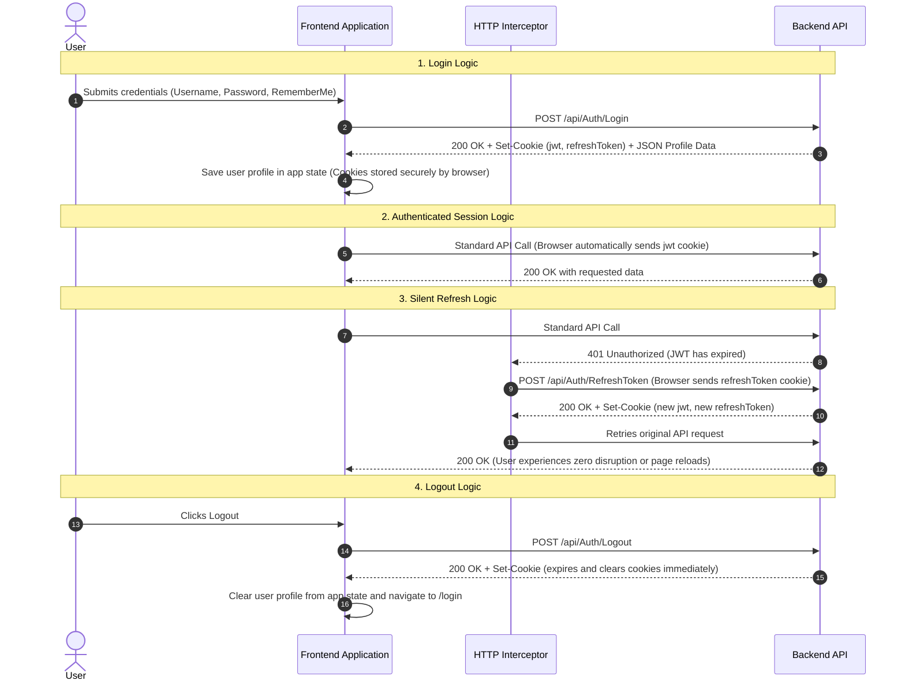

# Frontend Integration & Architecture Guide (Logic & Contract Reference)

This guide provides the architectural logic, authentication flows, error handling contracts, and API integration rules for the frontend team connecting to the **Enterprise Backend API Template**.

---

## 1. Core Architectural Concepts & Changes

| Area | ❌ Legacy Behavior | ✅ New Template Logic |
| :--- | :--- | :--- |
| **Token Handling** | Frontend manually stored JWT in `localStorage` and attached `Authorization: Bearer` headers. | **HttpOnly & Secure Cookies**: Browser handles token transmission automatically; JavaScript never touches or stores raw tokens. |
| **Login Response** | Backend returned raw token strings in the JSON body. | Backend sends `Set-Cookie` headers; JSON body contains **user profile data only**. |
| **Token Expiry & Refresh** | Frontend tracked expiration timers or sent manual refresh requests with stored tokens. | **Silent Refresh Interceptor**: When an API call returns `401 Unauthorized`, an interceptor transparently calls the refresh endpoint and retries the original request. |
| **Response Contract** | Responses had inconsistent formats (arrays, raw objects, dictionaries, ProblemDetails). | **Unified `ApiResponse` Envelope**: Every endpoint returns the exact same top-level structure for both success and failure. |
| **Entity Relational Binding** | Sent display strings (e.g. `roleName: "Admin"`). | **ID-based Binding**: Frontend sends IDs (e.g. `roleId: "guid"`) matching select dropdown values. |
| **Pagination & Sorting** | Multiple parameter conventions (`sortDirection`, `isAsc`, mixed casings). | **Unified Query Parameters**: `pageIndex`, `pageSize`, `search`, `sort` (property name), and `isAscending` (`true`/`false`). |
| **Localization & Messages** | Frontend maintained duplicate error translation files. | **Server-Side Localization**: Server returns pre-translated messages in Arabic or English based on the `Accept-Language` header. |

---

## 2. Authentication & Session Management Logic

### 2.1 Why HttpOnly Cookies?
* **XSS Attack Immunity:** Malicious scripts injected via third-party libraries or user inputs cannot read `HttpOnly` cookies.
* **Automatic Transmission:** The browser automatically attaches authentication cookies to every request directed at the API domain when `withCredentials` is enabled.
* **Zero Client-Side Token Storage:** React application state (Context/Redux/Zustand) should only store user identity details (Name, Username, Email, Roles), and never tokens.

### 2.2 End-to-End Authentication Flow Logic

---

## 3. Silent Token Refresh Logic & Queue Handling

To ensure multiple concurrent API calls do not trigger multiple refresh requests simultaneously:

1. **Detection:** When any outgoing API request receives an HTTP `401 Unauthorized` status (excluding the `/Auth/Login` and `/Auth/RefreshToken` endpoints themselves):
2. **Queueing:** 
   - If a refresh request is **already in progress**, add the incoming failed request callback to a queue and wait.
   - If **no refresh is active**, set a refreshing flag, mark the request as retried, and trigger `POST /api/Auth/RefreshToken`.
3. **On Refresh Success:**
   - Flush the queued requests and retry all of them with the newly set cookies.
   - Retry the initial failed request.
4. **On Refresh Failure (Session Expired or Revoked):**
   - Reject all queued requests.
   - Clear local application state.
   - Redirect the user to `/login`.

---

## 4. Unified Response Envelope & Error Handling Logic

### 4.1 The Unified Envelope Contract

Every response received from the backend follows this logical structure:

* **`isSuccess`** *(boolean)*: Indicates whether the operation succeeded (`true`) or failed (`false`).
* **`statusCode`** *(integer)*: Standard HTTP status code (`200`, `201`, `204`, `400`, `401`, `403`, `404`, `409`, `423`, `429`, `500`).
* **`message`** *(string)*: Pre-translated, user-friendly message from the backend in the requested language.
* **`data`** *(object / array / null)*: The main business payload. For actions that do not return data (or deletes), this is `null`.
* **`errors`** *(array of objects)*: List of validation or business error items. Each item contains:
  * **`code`**: The specific field name (e.g. `userName`, `password`) or business rule code.
  * **`description`**: The pre-translated explanation of the error.
  * **`type`**: The category of error (`Validation`, `NotFound`, `Conflict`, `Unauthorized`, `Forbidden`, `Locked`).
* **`traceId`** *(string)*: Unique request correlation ID for debugging and audit logs.

---

### 4.2 Frontend Error Handling Rules

1. **Account Lockout (`423 Locked`):**
   - Triggered when a user enters 5 consecutive incorrect passwords.
   - Action: Display a warning notification with the backend message (e.g. *"Account is temporarily locked. Please try again in 15 minutes."*). Disable login submit button during cooldown if desired.
2. **Rate Limiting (`429 Too Many Requests`):**
   - Triggered when exceeding endpoint request limits (e.g. over 10 login attempts per minute).
   - Action: Display a rate limit warning banner or toast.
3. **Form & Field Validation (`400 Bad Request` with `errors` array):**
   - Action: Iterate through the `errors` array, match each `error.code` to the corresponding form field input, and display the localized message directly below that input. Show the overall `message` in a toast.
4. **General Business Errors (`404 Not Found`, `409 Conflict`, `403 Forbidden`):**
   - Action: Display `apiRes.message` directly in a global toast or notification banner.

---

## 5. Domain Features & Data Contract Rules

### 5.1 Relational Binding Logic (Roles & Lookups)
* When populating dropdown lists (e.g. Roles, Categories, Departments), retrieve the lookup list from `GET /api/[Entity]/ListAll`.
* Bind the **display name** (`roleName`) to the dropdown label visible to the user.
* Bind the **unique identifier** (`roleId`) to the select value.
* When submitting forms (e.g., Create User, Edit User), send the `roleId` in the request body, not the string name.

### 5.2 Pagination & Query Parameters Contract
All paginated list endpoints expect the following query parameter logic:

* **`pageIndex`** *(integer, minimum 1)*: The requested page number.
* **`pageSize`** *(integer, default 10, max 50)*: Number of records per page.
* **`search`** *(string, optional)*: Keyword to filter records by name, code, or description.
* **`sort`** *(string, optional)*: The column/property name to order by (e.g. `userCode`, `createdAt`).
* **`isAscending`** *(boolean, optional, default `true`)*: `true` for Ascending (A-Z / 1-9), `false` for Descending (Z-A / 9-1).

#### Paginated Response Data Structure:
Paginated responses contain the following payload inside `data`:
* **`items`**: Array of entity records for the current page.
* **`pageIndex`**: Current active page.
* **`pageSize`**: Current page size.
* **`totalCount`**: Total number of matching records in the database across all pages.
* **`totalPages`**: Total number of pages available (`ceil(totalCount / pageSize)`).
* **`hasPreviousPage`**: `true` if `pageIndex > 1`.
* **`hasNextPage`**: `true` if `pageIndex < totalPages`.

---

### 5.3 Localization & Language Switching Logic
* The frontend passes the user's active language via the **`Accept-Language` HTTP header** (e.g. `'ar'` for Arabic, `'en'` for English).
* The backend inspects this header and automatically returns all validation errors, failure reasons, and success messages translated into that language.
* When the user toggles language in the frontend UI, update the default header on the HTTP client; all subsequent API responses will automatically arrive in the new language without needing client-side dictionary lookups.

---

## 6. Frontend Verification Checklist

- [ ] **Cookie Verification:** Ensure `jwt` and `refreshToken` cookies appear in browser DevTools with `HttpOnly` and `Secure` attributes upon successful login.
- [ ] **State Cleanliness:** Ensure application state/store holds only user profile information and **zero tokens in localStorage or sessionStorage**.
- [ ] **Transparent Session Recovery:** In DevTools, delete the `jwt` cookie while keeping the `refreshToken` cookie, then trigger an action; verify the request succeeds without logging the user out.
- [ ] **Account Lockout Experience:** Enter wrong passwords 5 times; verify the application handles the `423 Locked` response gracefully.
- [ ] **ID Binding:** Verify form submissions transmit relational IDs (`roleId`) instead of display names.
- [ ] **Pagination Controls:** Verify grid/table pagination accurately reflects `totalCount`, `totalPages`, `hasPreviousPage`, and `hasNextPage`.
- [ ] **Language Switching:** Change language in application settings; verify API responses and validation messages arrive localized in the selected language.
