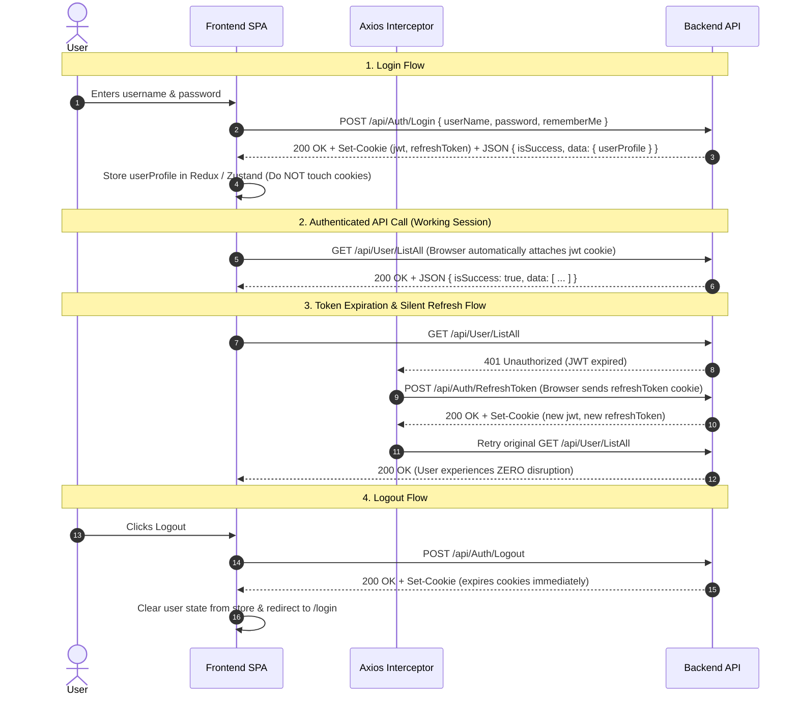

# Frontend Integration Guide & Migration Blueprint

This guide is designed for frontend developers (React, Angular, Vue, Next.js, etc.) integrating with the **Enterprise Backend API Template**. It details the **core architectural changes**, **HTTP client setup (Axios)**, **authentication & cookie handling**, **unified error handling**, **role management**, and **pagination**.

---

## 1. Quick Summary of What Changed

| Area | ❌ Old / Legacy Way | ✅ New Template Standard |
| :--- | :--- | :--- |
| **Token Storage** | Stored in `localStorage` (XSS vulnerable) | **HttpOnly & Secure Cookies** (`jwt`, `refreshToken`) |
| **Login Response** | Returned `token` string in JSON body | Returned in `Set-Cookie` header; JSON body contains **user profile only** |
| **HTTP Client** | Manually set `Authorization: Bearer <token>` | Set **`withCredentials: true`** (browser sends cookies automatically) |
| **Token Refresh** | Sent token strings manually in POST body | Calls `POST /api/Auth/RefreshToken` with empty body `{}` via cookies |
| **Error Formats** | 5 chaotic formats (dictionaries, ProblemDetails, raw arrays) | **Single Unified `ApiResponse<T>` envelope** |
| **User-Role Binding** | Sent `roleName` string | Sends **`roleId`** (matches dropdown values) |
| **Sorting** | Sent enum strings (`Asc`, `Desc`) | Sends **`sort`** (column name) and **`isAscending`** (`true`/`false`) |
| **Localization** | Frontend had to maintain translation dictionaries for errors | Server sends **pre-translated messages** based on `Accept-Language` |

---

## 2. Axios Configuration & Setup

### 2.1 Base Axios Instance (`AxiosInstance.js` / `apiClient.ts`)

Because tokens are now stored in **HttpOnly cookies**, you **do NOT need to attach `Authorization: Bearer ...` headers manually**. Instead, enable `withCredentials: true`:

```typescript
import axios from 'axios';

export const apiClient = axios.create({
  baseURL: 'https://your-api-domain.com/api',
  withCredentials: true, // ⚠️ CRITICAL: Allows browser to send & receive HttpOnly cookies
  headers: {
    'Content-Type': 'application/json',
    'Accept-Language': localStorage.getItem('lang') || 'en' // 'ar' or 'en'
  }
});
```

---

## 3. Authentication & Silent Refresh Flow



---

### 3.2 Complete Axios Interceptor with Silent Refresh Queue

To prevent race conditions when multiple API calls fail simultaneously with `401`, implement a **refresh queue**:

```typescript
import axios, { AxiosError, InternalAxiosRequestConfig } from 'axios';
import { apiClient } from './apiClient';

let isRefreshing = false;
let failedQueue: Array<{
  resolve: (value?: unknown) => void;
  reject: (reason?: unknown) => void;
}> = [];

const processQueue = (error: AxiosError | null) => {
  failedQueue.forEach(prom => {
    if (error) {
      prom.reject(error);
    } else {
      prom.resolve();
    }
  });
  failedQueue = [];
};

apiClient.interceptors.response.use(
  response => response,
  async (error: AxiosError) => {
    const originalRequest = error.config as InternalAxiosRequestConfig & { _retry?: boolean };

    // If request failed with 401 and was NOT already a login/refresh request
    if (
      error.response?.status === 401 &&
      !originalRequest._retry &&
      !originalRequest.url?.includes('/Auth/Login') &&
      !originalRequest.url?.includes('/Auth/RefreshToken')
    ) {
      if (isRefreshing) {
        // Queue parallel requests while refresh is in progress
        return new Promise((resolve, reject) => {
          failedQueue.push({ resolve, reject });
        })
          .then(() => apiClient(originalRequest))
          .catch(err => Promise.reject(err));
      }

      originalRequest._retry = true;
      isRefreshing = true;

      try {
        // Silent refresh: browser automatically sends HttpOnly refreshToken cookie
        await axios.post(
          `${apiClient.defaults.baseURL}/Auth/RefreshToken`,
          {},
          { withCredentials: true }
        );

        processQueue(null);
        return apiClient(originalRequest); // Retry original request
      } catch (refreshError) {
        processQueue(refreshError as AxiosError);
        // Refresh token expired or revoked -> redirect to login
        window.location.href = '/login';
        return Promise.reject(refreshError);
      } finally {
        isRefreshing = false;
      }
    }

    return Promise.reject(error);
  }
);
```

---

## 4. Unified Response & Error Handling

### 4.1 Response Envelope Structure

Every backend endpoint returns the exact same interface:

```typescript
export interface ApiResponse<T = any> {
  isSuccess: boolean;
  statusCode: number;
  message: string;       // Pre-translated server message (e.g. "تم تسجيل الدخول بنجاح")
  data: T | null;        // Main payload
  errors: ApiErrorItem[];// Field-level or business validation errors
  traceId: string;       // Server correlation ID for debugging
}

export interface ApiErrorItem {
  code: string;          // Field name or error code (e.g. "UserName", "Auth.InvalidCredentials")
  description: string;   // Localized error message
  type: string;          // "Validation" | "NotFound" | "Unauthorized" | "Forbidden" | "Conflict" | "Locked"
}
```

---

### 4.2 Standard UI Consumption Pattern

```typescript
// Example: Creating a user
async function handleCreateUser(formValues: CreateUserForm) {
  try {
    const res = await apiClient.post<ApiResponse>('/User/Add', {
      userCode: formValues.code,
      password: formValues.password,
      roleId: formValues.selectedRoleId // ⚠️ Send roleId, NOT roleName
    });

    // 1. Success Toast (Message is already localized)
    toast.success(res.data.message);
    navigate('/users');
  } catch (err: any) {
    const apiRes: ApiResponse = err.response?.data;

    if (apiRes) {
      // 2. HTTP 423: Account Locked (e.g. 5 failed login attempts)
      if (apiRes.statusCode === 423) {
        toast.error(`Account Locked: ${apiRes.message}`);
        return;
      }

      // 3. HTTP 429: Rate Limited
      if (apiRes.statusCode === 429) {
        toast.error('Too many requests. Please wait a minute before trying again.');
        return;
      }

      // 4. Form Validation Errors (Map errors to input fields)
      if (apiRes.errors && apiRes.errors.length > 0) {
        apiRes.errors.forEach(error => {
          formikOrReactHookForm.setError(error.code.toLowerCase(), {
            message: error.description
          });
        });
      } else {
        // Fallback to top-level message
        toast.error(apiRes.message);
      }
    } else {
      toast.error('Network error. Please check your connection.');
    }
  }
}
```

---

## 5. Role & User-Role Management

### 5.1 Dropdowns & Selections (`RoleId` Standard)

When rendering role dropdowns in User forms, bind **`roleId`** as the value:

```typescript
// 1. Fetch available roles (GET /api/Role/ListAll or GET /api/User/ListAllRoles)
const rolesResponse = await apiClient.get<ApiResponse<RoleDto[]>>('/Role/ListAll');
const roleOptions = rolesResponse.data.data.map(role => ({
  value: role.roleId,   // ⚠️ Pass roleId to backend
  label: role.roleName   // Display roleName in UI
}));

// 2. Submit user creation payload:
const payload = {
  userCode: "1005",
  password: "Password@123",
  roleId: selectedRole.value // e.g., "e4d13c7a-5b12-4c8d-..."
};
```

---

## 6. Pagination & Query Parameters

### 6.1 Request Query Contract

All search and list endpoints use `BaseQueryParams`:

| Parameter | Type | Default | Description |
| :--- | :--- | :--- | :--- |
| `pageIndex` | `number` | `1` | 1-based current page index |
| `pageSize` | `number` | `10` | Number of items per page (Max 100) |
| `search` | `string` | `null` | Global search term |
| `sort` | `string` | `null` | Property to sort by (e.g. `"userName"`, `"createdAt"`) |
| `isAscending` | `boolean` | `true` | `true` for ASC, `false` for DESC |

### 6.2 Paginated Response Structure

```typescript
export interface PaginatedResult<T> {
  pageIndex: number;
  pageSize: number;
  totalCount: number;
  totalPages: number;
  hasPreviousPage: boolean;
  hasNextPage: boolean;
  items: T[];
}

// Example: Fetching users
const response = await apiClient.get<ApiResponse<PaginatedResult<UserDto>>>('/User/ListAll', {
  params: {
    pageIndex: 1,
    pageSize: 10,
    search: 'GS',
    sort: 'createdAt',
    isAscending: false
  }
});

const { items, totalCount, totalPages } = response.data.data;
```

---

## 7. Frontend Migration Checklist

- [ ] **Remove `localStorage.setItem('token', ...)`**: Delete token storage logic on login.
- [ ] **Enable `withCredentials: true`** on the Axios instance.
- [ ] **Update 401 Interceptor**: Call `POST /api/Auth/RefreshToken` with `{}` instead of manual header manipulation.
- [ ] **Simplify Response Handlers**: Read `res.data.data` for payloads and `res.data.message` for UI notifications.
- [ ] **Update Form Field Validation**: Map `res.data.errors` (`error.code` $\to$ field name).
- [ ] **Ensure Role Selection Uses `roleId`**: Update dropdowns in User Add/Edit components to send `roleId`.
- [ ] **Pass `Accept-Language` Header**: Set `Accept-Language: 'ar'` or `'en'` to receive automatically translated backend messages.
